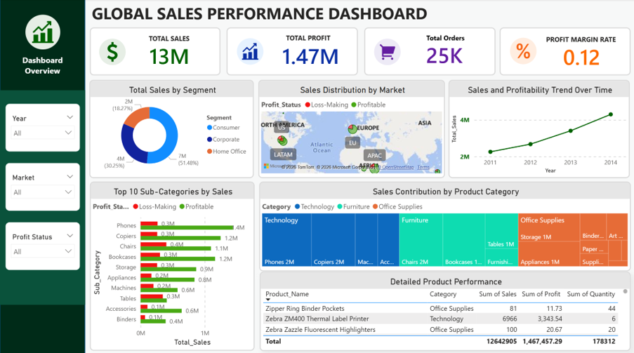

# Global Sales Performance Dashboard

**An interactive Power BI dashboard for exploring sales performance, profitability, customer segments, and product trends.**

This project was developed for **CDS512 – Business Intelligence and Decision Analytics** at Universiti Sains Malaysia (USM). It transforms historical retail transactions into an accessible dashboard that supports performance monitoring and more informed business decisions.

## Dashboard Preview



## Project Overview

Using the **Global Superstore Sales Dataset** sourced from Kaggle, the dashboard analyses approximately **50,000 sales records from 2011–2014**. It helps users answer questions such as:

- How are sales and profits changing over time?
- Which markets and product categories drive performance?
- Are high-selling products always profitable?
- Which customer segments contribute the most revenue?

## Dashboard Features

**Key performance indicators**
- Total Sales
- Total Profit
- Total Orders
- Profit Margin Rate

**Interactive visualisations**
- Sales distribution by market (map)
- Sales and profitability trends over time (line chart)
- Top 10 sub-categories by sales (bar chart)
- Sales contribution by product category (treemap)
- Sales by customer segment (donut chart)
- Detailed product performance (table)

**Exploration tools**
- Multi-select slicers for Year, Market, and Profit Status
- Cross-filtering between visualisations
- Tooltips for additional context
- Comparison of profitable and loss-making transactions

## Tools & Techniques

- **Power BI Desktop** — dashboard design and data visualisation
- **Power BI data preparation** — data cleaning, column standardisation, and data-type checks
- **DAX** — KPI measures and profit-status classification
- **Business intelligence analysis** — descriptive, diagnostic, and comparative analysis

Selected DAX calculations:

```dax
Total_Sales = SUM('superstore'[Sales])
Total_Profit = SUM('superstore'[Profit])
Total_Orders = DISTINCTCOUNT('superstore'[Order_ID])
Total_Quantity = SUM('superstore'[Quantity])
Profit_Margin_Rate = DIVIDE(SUM('superstore'[Profit]), SUM('superstore'[Sales]), 0)
Profit_Status = IF('superstore'[Profit] > 0, "Profitable", "Loss-Making")
```

*Profit_Status is a calculated column; the other expressions are measures.*

## Key Business Insights

1. **Technology leads sales performance.** Technology was the highest-selling category and showed strong growth from 2011 to 2014, making it an important focus for inventory planning and sales strategy.
2. **Revenue does not guarantee profit.** Some high-selling sub-categories also contained loss-making transactions, highlighting the need to examine margins, discounts, and operating costs alongside sales.
3. **Consumers are the largest customer segment.** Consumer customers contributed just over half of sales, suggesting opportunities for targeted retention efforts while also developing Corporate and Home Office segments.
4. **Sales are concentrated in selected products.** Leading sub-categories such as Phones, Copiers, and Chairs are important revenue drivers, but product-level profitability should guide purchasing and promotion decisions.

These findings are based on the historical dataset and illustrate business intelligence analysis rather than current retail performance.

## How to Explore

1. Download the `.pbix` file from this repository.
2. Install and open **Microsoft Power BI Desktop**.
3. Open the `.pbix` file to explore the interactive dashboard.
4. Use the Year, Market, and Profit Status slicers to investigate different views.

**Note:** GitHub cannot display an interactive `.pbix` report directly. Power BI Desktop is required to open it.

## Dataset

- **Source:** Global Superstore Sales Dataset, obtained from Kaggle
- **Period:** 2011–2014
- **Size:** Approximately 50,000 transaction records
- **Dimensions:** Sales, profit, orders, products, customer segments, and markets

Check the original dataset's redistribution terms before publishing the underlying data or an embedded copy inside the PBIX file.

## Project Credits

**Group project — Universiti Sains Malaysia (USM)**

**Course:** CDS512 – Business Intelligence and Decision Analytics

**Contributors:** Grace Tan Ying Hui and Yeoh Jing Lin
